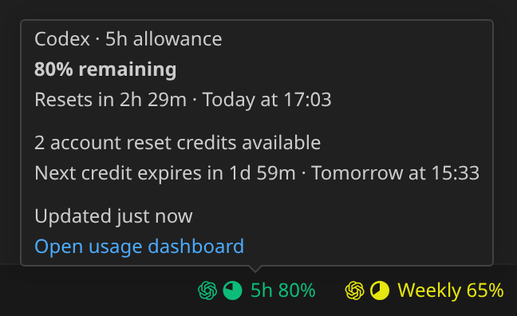

# Codex Usage Status


[](https://www.gnu.org/licenses/gpl-3.0)

A VS Code extension that shows your remaining Codex allowance in the status bar. Hover over it to see reset times, account reset credits and the last successful check.

The extension reads account rate limits through a local `codex app-server` process. It displays the allowance windows returned for your account, including separate limit names when more than one is available.



Captured in VS Code with sample usage data and the default warning and critical thresholds.

## Prerequisites

- VS Code 1.66.0 or later.
- A Codex executable, either bundled with the installed OpenAI extension or available as `codex` on your `PATH`. You can also configure an absolute path.
- Codex signed in with your ChatGPT account, with allowance data available for that account.

## Installation

Install a packaged `.vsix` file through **Extensions: Install from VSIX...** in the VS Code Command Palette. To run the extension from this repository, follow the development instructions below.

The extension starts after VS Code finishes loading and checks usage immediately.

## Usage

Each allowance window appears as the ChatGPT logo followed by a circular gauge with its exact percentage remaining. The gauge rounds fractional percentages to the nearest whole percentage. Each allowance's logo, gauge and text change colour independently, using your theme's green, yellow and red terminal colours.

The allowance gauges appear once usage loads. A separate loading or unavailable message appears when there are no allowance values to display.

Each tooltip title identifies its allowance window, such as `Codex · 5h allowance` or `Codex · Weekly allowance`. The next line shows the remaining percentage in bold, followed by the time until reset, such as `Resets in 1h 29m · Today at 23:02`. Reset times use your local time zone and a 24-hour clock. Resets beyond tomorrow show a short date, and overdue resets show `Reset due`.

The tooltip groups allowance details and account reset credits into separate blocks. The last successful check and usage-dashboard link share a compact footer below any error or stale warning. The check appears as `Updated just now`, `Updated 1 min ago`, or an age in hours or days.

When Codex provides reset credits, each allowance tooltip shows the account total, such as `2 account reset credits available`. The same total appears in every allowance tooltip because the response does not identify eligible windows. These credits are separate from the allowance's scheduled reset. The total starts with the reported count and subtracts listed credits as they expire. If listed available credits outnumber the reported total, the tooltip keeps that total and omits expiry details. A reported zero appears as `0 account reset credits available`.

When credit details are available, the tooltip shows the nearest expiry on the line below the credit count, such as `Next credit expires in 2h 30m · Tomorrow at 00:00`. Credit expiries use the same countdown, local date and 24-hour clock as allowance reset times, and refresh every minute. A `null` expiry means the credit does not expire. When all available credits are known to be non-expiring, the tooltip says `This credit does not expire` or `These credits do not expire`. Missing or invalid expiry times appear as `Next credit expires at an unknown time`.

Partial credit lists, unknown availability or missing expiry times make the nearest expiry uncertain. The tooltip uses `Earliest known credit expires` when a timed expiry is known but other credits could expire sooner. Non-expiring credits do not make expiry information incomplete. If Codex provides only a count, the tooltip omits the expiry. If the reset-credit field is missing or unavailable, the tooltip omits the reset summary. The extension reads these fields from the same usage check. See the [Codex app-server documentation](https://learn.chatgpt.com/docs/app-server#6-rate-limits-chatgpt) for the response fields.

Countdowns and update ages refresh every minute, independently of usage checks.

- Run **Codex Usage: Refresh** to check again.
- Run **Codex Usage: Open Usage Dashboard**, or use the tooltip link, to open the account usage page.
- Each allowance is red at or below the configured critical threshold, yellow at or below the warning threshold, and green otherwise. The warning threshold defaults to 66%. The critical threshold defaults to 33% and takes precedence over the warning threshold.
- Each allowance keeps its previous value and shows a `stale` label if a refresh fails, more than two refresh intervals have elapsed since the last success, or a reported reset time has passed.

## Settings

Search for `Codex Usage` in VS Code Settings, or edit these values in your user `settings.json`:

| Setting | Default | Description |
| --- | --- | --- |
| `codexUsage.executablePath` | `""` | Absolute path to the Codex executable. When empty, the extension checks the installed OpenAI extension's bundled executable, then tries `codex` on `PATH`. |
| `codexUsage.refreshIntervalSeconds` | `60` | Seconds between checks. The setting accepts 30 to 3600. |
| `codexUsage.warningThresholdPercent` | `66` | Colour an allowance yellow at this percentage remaining or less. Accepts 0 to 100. The critical threshold takes precedence. |
| `codexUsage.criticalThresholdPercent` | `33` | Colour an allowance red at this percentage remaining or less. Accepts 0 to 100. Takes precedence over the warning threshold. |

Changing a colour threshold updates the displayed allowances immediately. Changing the refresh interval reschedules checks and keeps the connection and last successful reading. Changing the executable path restarts the connection and checks usage again.

## Troubleshooting

If the status bar shows `Codex: unavailable`, hover over it for the error.

- If the executable cannot be found, install Codex or set `codexUsage.executablePath` to its absolute path. Relative paths are rejected.
- If the account returns no allowance windows, check that Codex is signed in with your ChatGPT account and that the account has usage data available.
- If a request times out or the app server stops, run **Codex Usage: Refresh** to retry. The extension also retries at the next scheduled check.

A stale value is the result of an earlier successful check. Refresh it before relying on the displayed allowance.

## Development

Use Node.js 20 or later to run the development checks, and Python 3 to build a VSIX. Run `npm ci` to install the development dependencies.

1. Open this repository in VS Code.
2. Press **F5** with the **Run Codex Usage Status** launch configuration selected.
3. Check the status bar in the Extension Development Host window.

Run the client, usage and status bar tests with:

```sh
npm test
```

The packaging command is:

```sh
npm run package
```

It writes `dist/codex-usage-status-<version>.vsix` using the version in `package.json`.

The icon font in `media/gauges.woff` contains 101 gauges, one for each whole percentage from 0% to 100%, and the ChatGPT logo from `media/chatgpt.svg`. To change the icons, activate a virtual environment with Python 3.11 or later. Install the pinned FontTools dependency with `python3 -m pip install -r requirements-dev.txt`, then run `python3 scripts/generate_gauges.py`. This regenerates the font and its icon declarations in `package.json`. Normal packaging does not require FontTools.

With that virtual environment active, run `npm run check:icons` to compare the generated font and icon declarations with the committed files and test the SVG input checks. This command requires FontTools. `npm test` runs the JavaScript tests without it.

The logo SVG must have a `viewBox` with four finite numbers and positive width and height. Numbers can use whitespace or comma separators.

The SVG must contain exactly one direct filled `path`, with an optional `title`. Combine shapes into a single compound path. Resolve overlaps so filled regions and holes follow the nonzero winding rule. The generator rejects multiple paths, groups, transforms, strokes, CSS styling and other SVG elements or attributes. Convert these constructs to the compound path before regenerating the font. The fill colour becomes the status bar item's theme colour.

## VS Code compatibility tests

CI checks the VS Code API, unit tests, and icon assets, then tests the VSIX on the declared minimum and current stable releases. To run the API check and packaged extension tests locally:

```sh
npm run check:vscode-api
npm run test:compat
```

Headless Linux needs Xvfb and the Electron display libraries. With those installed, use `xvfb-run -a npm run test:compat`.

See the [compatibility guide](docs/vscode-compatibility.md) for setup, release options, test coverage and isolation, and the findings behind the minimum VS Code version.

## Contributing

Open an issue to discuss proposed changes before submitting a pull request. Use Conventional Commits and follow the [contributing guide](.github/CONTRIBUTING.md) for branching, commits, pull requests, and code style.

## Licence

This project is licensed under the GNU General Public License v3.0. See [LICENCE](LICENCE) for details.
